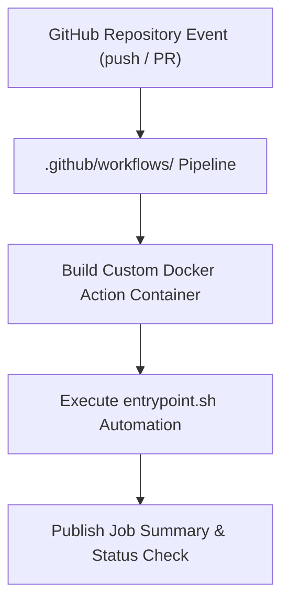

# Hello GitHub Actions

> **Author & Architect:** [Robina Mirbahar](https://github.com/RobinaMirbahar) ([Google Developer Expert in Cloud & AI](https://developers.google.com/profile/u/106918534005910641104?utm_campaign=deveco_gdemembers&utm_source=deveco) · Google Cloud Champion Innovator · Co-Author of [*AI Engineering*](https://www.amazon.com/dp/B0GWCZWCF4))  
> 📚 **Architecture Track:** Event-Driven GitHub Actions Automation & Containerized Workflow Steps  
> **Core Stack:** GitHub Actions YAML Workflows, Docker Container Actions, and Automated CI Triggers.

---

## 🎯 Why I Built Hello GitHub Actions — CI/CD Automation Starter (Engineering Purpose & Real-World Value)

### 1. ⚙️ Mastering Event-Driven Repository Automation
I built this starter workflow repository to demonstrate how GitHub events (`push`, `pull_request`, `workflow_dispatch`) trigger containerized jobs and custom shell scripts automatically.

### 2. 🐳 Custom Docker Action Packaging
Includes a custom `Dockerfile` action and `entrypoint.sh` script showing how to package repeatable DevOps tasks into reusable workflow steps.

### 3. 📐 Clean Reference for CI/CD Onboarding
Provides a concise, readable reference for students and engineers learning GitHub Actions fundamentals.

---

## 🏗️ System Architecture

---

Hey RobinaMirbahar!

Mona here. I'm done preparing your exercise. Hope you enjoy! 💚

Remember, it's self-paced so feel free to take a break! ☕️

---

&copy; 2025 GitHub &bull; [Code of Conduct](https://www.contributor-covenant.org/version/2/1/code_of_conduct/code_of_conduct.md) &bull; [MIT License](https://gh.io/mit)
---

### Official Google Developer Resources
- [Google for Developers](https://developers.google.com/?utm_campaign=deveco_gdemembers&utm_source=deveco)
- [Google Cloud AI Documentation](https://cloud.google.com/ai?utm_campaign=deveco_gdemembers&utm_source=deveco)
